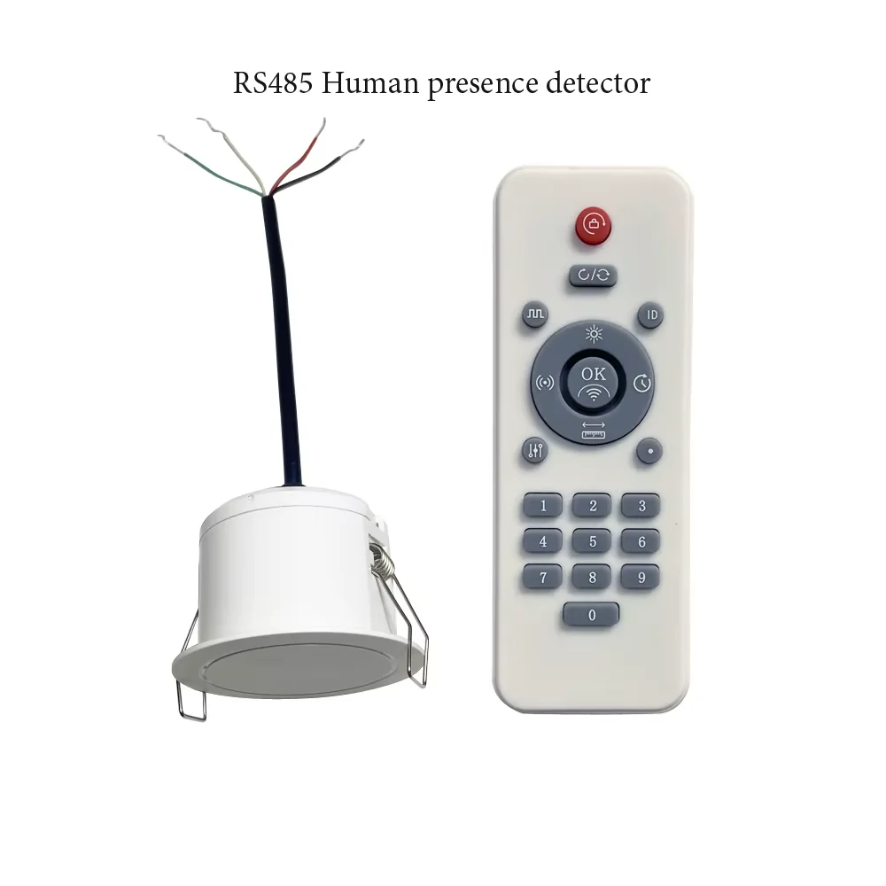
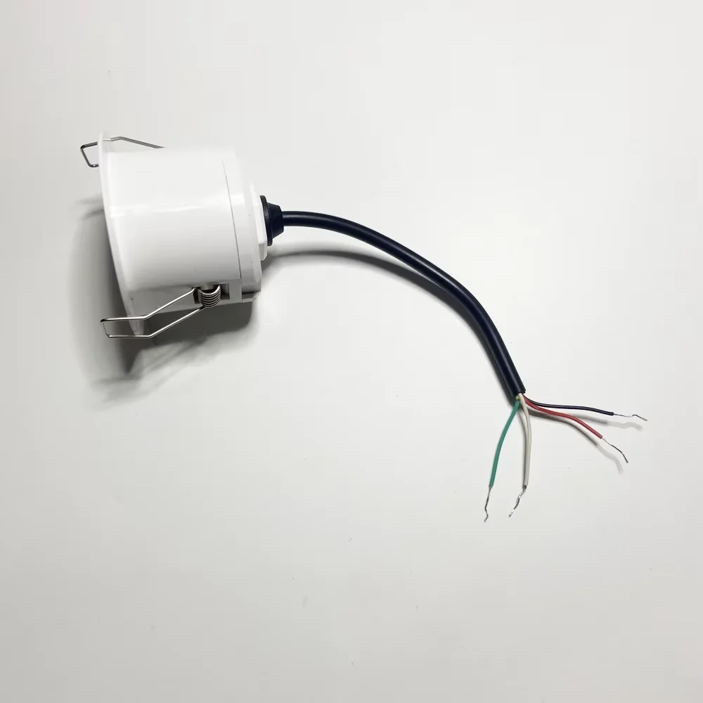

# MTDx62 Presence Sensor

Home Assistant integration for the **MTD062-MB** (5.8 GHz) and **MTD262-MB** (24 GHz) human
presence sensors, reached over Modbus RTU or Modbus TCP.

The sensor detects a person by breathing and small movements, not just by motion, so it keeps
reporting presence for someone sitting still. This integration turns that into an occupancy
binary sensor, adds illuminance and target distance, and exposes the device's own health.

The sensor is a ceiling-mounted radar unit with an RS485 interface, configured over the bus or
with an infrared remote. It reaches Home Assistant through Home Assistant's own
[Modbus](https://www.home-assistant.io/integrations/modbus/) integration: this integration never
opens the port itself, so several sensors on one bus, and other Modbus devices, share the
connection.

Dimensions, the internals of both radio versions and everything about the protocol — register
map, health codes, what the device does when the bus is cut — live in the
[library repository](https://github.com/sergeyastakhov/mtdx62-modbus-library#the-device).

## Supported devices

| Model | Radio | Connection |
|---|---|---|
| MTD062-MB | 5.8 GHz | RS485 (Modbus RTU) or a Modbus TCP gateway |
| MTD262-MB | 24 GHz | RS485 (Modbus RTU) or a Modbus TCP gateway |

Both models report the same registers, so the model is selected when the device is added.

The same housing is also made without Modbus: the **MTD061-RC** (5.8 GHz) and **MTD261-RC**
(24 GHz) switch a dry contact — a relay up to 24 V and 100 mA — and know nothing about Modbus.
Those are not supported here; their signal goes to a binary input or a smart relay.

Devices that look the same are sold under other names, and Bluetooth variants exist. Only a model
whose name ends in `-MB` speaks Modbus RTU; check the label on the back before buying.

These are OEM units: the factory prints whichever brand a customer orders, so the device carries no
manufacturer logo. The icon and logo in `brand/` are a drawing of the sensor itself, not a
trademark, and they will stay that way until a vendor with its own branding adopts the hardware.

## Installation

The integration is distributed through the [Marketplace](https://www.home-assistant.io/integrations/marketplace):
add this repository, install **MTDx62 Presence Sensor**, restart Home Assistant.

## Setup

One device is one config entry. Several sensors on one RS485 bus share a single Modbus
connection automatically: add each one separately with its own bus address, and the connection
is reused.

1. **Settings → Devices & services → Add integration → MTDx62 Presence Sensor**.
2. Choose **Modbus TCP** for a gateway, or **Serial port (Modbus RTU)** for a direct RS485 link:
   a UART header on the board, an RS485 HAT, or an adapter.
3. Enter the connection settings and the sensor's address on the bus (1–247).
4. Pick the model that is on the ceiling.

Default values match the factory settings: 9600 baud, no parity, one stop bit, unit id 1, TCP
port 502.

## Entities

| Entity | Meaning | Notes |
|---|---|---|
| Presence | someone is in the room | occupancy class, updated every 5 seconds |
| Illuminance | ambient light as the sensor sees it | lux, tenth of a lux |
| Target distance | distance to the detected target | metres, two decimals, disabled by default |
| Settings | detection range, zones, delays, sensitivities, light threshold | eight adjustable numbers |
| Device status | the sensor's own health code | diagnostic, disabled by default |
| Application version | firmware of the sensor | diagnostic, disabled by default |
| Radar version | firmware of the radar module | diagnostic, disabled by default |

Presence, illuminance and distance are shown only while the sensor reports that it is running
(health code 1, self-test passed). During power-up and after a self-test failure they go
unavailable instead of showing numbers nobody should trust; the device status entity and
diagnostics keep working, so the reason is visible. The state is what the sensor reports: there is
no extra filtering or debounce in Home Assistant. The entry delay, departure delay and sensitivity
of the sensor itself decide how quickly presence clears.

## Settings

The sensor's parameters are adjustable from Home Assistant, but they are **registered disabled**:
nothing in the device page can be changed until you decide to. To edit one:

1. Open the device, select **the entity you need** in the entity list (or find it under
   **Settings → Devices & services → Entities**).
2. Open its settings and turn it on (the switch next to **Enabled**).
3. The entity appears in the device page as a number and writes take effect immediately.

| Setting | Unit | Range |
|---|---|---|
| Detection range | m | 1.0 – 10.0 |
| Shielding zone | m | 0.3 – 10.0 |
| Entry indent | m | 0.0 – 10.0 |
| Entry delay | s | 0.0 – 5.0 |
| Departure delay | s | 5 – 1500 |
| Trigger sensitivity | — | 1 – 9 |
| Maintain sensitivity | — | 1 – 9 |
| Light threshold | lx | 0 – 420, `0` turns the function off |

Values come from the sensor's register map as measured on a real unit, not only as the vendor table
describes it. Two rules are worth knowing:

- **The zones must fit inside the range.** The sensor requires `shielding zone + entry indent` to
  stay below the detection range and answers with a Modbus exception `0x02` otherwise, which reads
  like "illegal address". The integration checks it first and says which values do not fit.
- **A write is not instant.** The sensor shows the previous value for up to half a second; the
  integration retries the confirmation read for a second before reporting a failure. Settings are
  re-read once a minute, so a change made with the infrared remote appears without a restart.

The light threshold gates the sensor's own output in the vendor documentation (presence only while
the room is darker than the threshold). That behaviour was not confirmed on a real unit — the flag
depends on a person being in the room — so treat the threshold as a stored parameter, not as a
verified gate.

> **Tip for dashboards.** If you enabled a setting and want to show it read-only on a dashboard, give
> the row `type: simple-entity` and turn off `tap_action` and `hold_action` in the entities card. That
> renders the value without a control; it does not stop other places from writing to it.

### Bus settings, in the entry's dialog

The bus address, speed and parity decide **how the sensor answers**, and a new value applies
immediately: after writing a new address the sensor stops answering on the old one. They are not
entities at all and live in the entry's dialog instead:

1. **Settings → Devices & services → the sensor → Configure**.
2. The form shows the three current values and a warning that the link will break.
3. Confirm on the next step; the three values go to the sensor in **one** request. Parity is
   offered as `N`, `E` or `O` — the same letters the setup form uses.
4. The sensor becomes unreachable from this entry, because the entry keeps the old connection
   settings. A repair says so.
5. Run **Reconfigure** on the entry and enter the new address, speed and parity to get it back. In the
   worst case the infrared remote restores the factory settings.

Parity is written the Modbus way everywhere — in the setup form, in this dialog and in the repair
message: `N` no parity, `E` even, `O` odd.

The integration never changes the entry's connection settings on its own: a wrong value would leave
the entry pointing at nothing, with no way back from inside Home Assistant.

## Diagnostic values

The **MAC code** sensor reads register `0x000D`. It is one register, not a full MAC address — on the
tested unit it reads `1` — so it is diagnostic, disabled by default and never written. It also appears
in the diagnostics download.

## How data is updated

The integration asks the sensor for four registers every 5 seconds, in one request per device.
The Modbus connection is shared with other integrations through Home Assistant's own `modbus`
integration, so nothing competes for the port.

If the sensor stops answering, entities go unavailable after three failed polls in a row; a
single lost frame on a busy bus does not disturb anything. The connection recovers by itself
when the sensor answers again — no restart, no reloading of the entry.

From the entry's page you can download diagnostics: measurements, the sensor's parameters, raw
register values and firmware versions, with the serial port path redacted.

## Known limitations

- The sensor accepts settings from Home Assistant, but it clamps values it does not like instead of
  refusing them: a detection range of 0.6 m is stored as 1.0 m, a shielding zone of 0.1 m as 0.3 m.
  The integration refuses those values so you see what you asked for.
- Electronics in metal enclosures, elevators and metal-panel rooms break the radar's readings;
  that is a property of the sensor, not of this integration.
- A reading that the vendor documented ambiguously (two parameter registers) is reported in
  diagnostics but not used.
- Polling is fixed at 5 seconds. On a slow bus with many sensors this is a noticeable load.

## Troubleshooting

- **"Could not reach the sensor"** — check the address on the bus, the baud rate and parity, and
  that no other program holds the serial port.
- **"Could not open this connection"** — the port exists but will not open. Two causes are common
  on a Raspberry Pi. A `modbus:` entry in `configuration.yaml` is served by the legacy hub, which
  opens the port through its own pymodbus client and is not part of the shared connection
  registry, so the port looks free from here until the open fails: remove the sensor from the
  YAML setup, or point it elsewhere. On an older stack a connection could also stay half-closed
  after a timeout
  ([modbus-connection#269](https://github.com/home-assistant-libs/modbus-connection/issues/269)),
  which `modbus-connection` 4.12.8 stopped doing; Home Assistant 2026.11 ships it.
- **"The port is already open as …"** — the same device is reached through two spellings, such as
  a `/dev/serial/by-id/…` link and `/dev/ttyUSB0`. Home Assistant tells connections apart by
  the path string, so use the name it gives you in both places.
- **"This sensor is already used with different connection settings"** — the same device is
  already configured with other link settings. Change them in the existing entry instead of
  adding a second one.
- **An error shows as a bare key, such as `cannot_open_link`** — the browser keeps the
  translation cache of Home Assistant and does not refresh it when a custom integration is
  updated, so texts added in that update are missing from the cache. Reload the page with
  `Ctrl+Shift+R`, or open Home Assistant in a private window. Restarting Home Assistant does not
  help: the cache lives in the browser.
- **Distance still shows centimetres after updating to 0.1.7** — Home Assistant keeps the unit a
  sensor was created with and converts to it, so an existing entity is unaffected by the change.
  Pick metres in the entity's settings (**Settings → Devices & services → Entities → the sensor →
  Unit of measurement**), or remove and re-add the device; a new entity starts in metres. A unit
  you chose yourself is likewise never overridden.
- **Presence stays on after everyone left** — that is the sensor's departure delay, set on the
  device. Check the device status entity for a health code.

## Removal

Delete the config entry under **Settings → Devices & services**. The Modbus connection is
released when the last entry using it is removed. Nothing is written to the sensor, so removing
the integration leaves the device exactly as it was.

## Development

The protocol lives in a separate package, [`mtdx62-modbus-library`](https://pypi.org/project/mtdx62-modbus-library/),
imported as `mtdx62_modbus_library`, built on
Home Assistant's `modbus-connection`. The integration only wires that package to entities and the
config flow; requirements and design live in `openspec/`.

The rules this integration follows are shared with every other device integration and kept in
[`ha-integration-workspace`](https://github.com/sergeyastakhov/ha-integration-workspace):

- [`conventions/modbus-setup`](https://github.com/sergeyastakhov/ha-integration-workspace/blob/main/openspec/specs/conventions/modbus-setup/spec.md)
  — how a device is taken from "add integration" to working entities: defaults that need no
  editing, a check before the entry is created, one entry per bus address.
- [`conventions/config-flow-errors`](https://github.com/sergeyastakhov/ha-integration-workspace/blob/main/openspec/specs/conventions/config-flow-errors/spec.md)
  — one cause per message, and the form keeps what you typed.
- [`conventions/live-verification`](https://github.com/sergeyastakhov/ha-integration-workspace/blob/main/openspec/specs/conventions/live-verification/spec.md)
  — a release is checked on a running Home Assistant with the real device, following the checklist
  in [`docs/live-check.md`](docs/live-check.md); the result goes into the release notes.

They are not repeated here on purpose. A rule that holds for every integration changes in that
repository, not in this one, so this README only describes what is specific to the MTDx62.

Both repositories are published from that workspace, which keeps the rules, the integration and the
protocol library side by side while they are being developed. Each one is pushed to its own
repository as an ordinary commit, so this repository is a copy of the integration folder and needs
nothing from the workspace to build or install.

## Author

Sergey Astakhov — [sergeyastakhov@mail.ru](mailto:sergeyastakhov@mail.ru),
[github.com/sergeyastakhov](https://github.com/sergeyastakhov).

Source and issues: <https://github.com/sergeyastakhov/ha-mtdx62>. MIT licensed.
